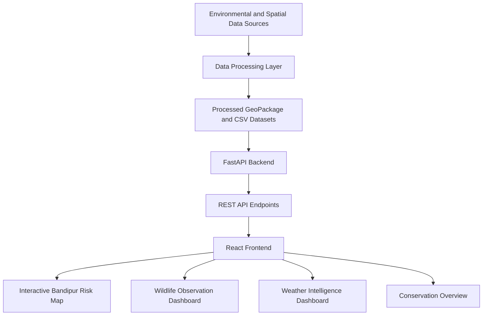

# WildGuard AI – System Architecture

## 1. Overview

WildGuard AI is a wildlife habitat threat assessment and conservation monitoring system developed for Bandipur Tiger Reserve, Karnataka, India.

The system integrates spatial, environmental, fire detection, wildlife observation, and human-access datasets to assess relative habitat threats and present the processed information through an interactive web dashboard.

The application follows a three-layer architecture:

1. Data Processing Layer
2. Backend API Layer
3. Frontend Visualization Layer

## 2. System Architecture

## 3. Data Processing Layer

The data processing layer prepares and integrates datasets required for spatial threat assessment and conservation monitoring.

### 3.1 Data Sources

The project uses the following datasets:

- NASA FIRMS VIIRS satellite fire detections.
- GBIF wildlife occurrence and observation records.
- OpenStreetMap roads and settlement information.
- ESA WorldCover 2021 land-cover data.
- NASA POWER weather data.
- Bandipur Tiger Reserve boundary data.

### 3.2 Data Processing

Python scripts are used to perform:

- Data cleaning and preprocessing.
- Spatial data integration.
- Coordinate reference system transformation.
- Creation of a 1 km spatial grid.
- Integration of fire, wildlife, vegetation, road, settlement, and weather information.
- Calculation of spatial threat scores.
- Classification of relative threat levels.
- Generation of summary datasets and visualizations.

The main spatial dataset is stored in GeoPackage format. Processed wildlife, weather, and fire summaries are stored in CSV format.

### 3.3 Spatial Risk Assessment

The system calculates two principal threat indicators:

**Fire Threat Assessment**

Fire threat scores combine normalized fire detection counts and mean Fire Radiative Power (FRP), using expert-defined weights.

**Human Access Pressure Assessment**

Human-access scores combine road density and proximity to settlements, using expert-defined weights.

The resulting scores are classified into relative Low, Moderate, and High categories using tertile-based thresholds.

These scores represent relative spatial threat indicators. They are not statistically trained predictions or probabilities of future incidents.

## 4. Backend API Layer

The backend is developed using Python and FastAPI.

It reads the processed GeoPackage and CSV datasets and exposes REST API endpoints to the frontend.

### 4.1 Technology Stack

- Python
- FastAPI
- Uvicorn
- Pandas
- GeoPandas

### 4.2 API Endpoints

| Endpoint | Method | Purpose |
|---|---|---|
| `/` | GET | Confirms that the backend is running. |
| `/api/health` | GET | Returns backend health information. |
| `/api/risk-map` | GET | Provides spatial risk information in GeoJSON format. |
| `/api/wildlife-summary` | GET | Provides wildlife observation statistics and annual summaries. |
| `/api/weather-summary` | GET | Provides monthly weather summaries and latest available weather indicators. |

The backend uses cached data-loading functions to avoid repeatedly reading the same processed datasets.

The risk map endpoint converts the spatial dataset to EPSG:4326 before returning GeoJSON data for frontend mapping.

## 5. Frontend Visualization Layer

The frontend is developed using React and Vite.

It communicates with the FastAPI backend through HTTP requests and displays the processed information through an interactive dashboard.

### 5.1 Technology Stack

- React
- React DOM
- Vite
- React Leaflet
- Leaflet
- JavaScript
- CSS

### 5.2 Dashboard Components

**Conservation Overview**

Displays key conservation and fire detection statistics.

**Bandipur Spatial Risk Map**

Displays the spatial risk grid on an interactive map. Users can switch between:

- Fire Threat
- Human Access Pressure

Map features display information about their corresponding risk categories, scores, and fire detections.

**Wildlife Observation Intelligence**

Displays:

- Total recorded wildlife observations.
- Number of unique recorded species.
- Observation class distribution.
- Annual wildlife observation trends.

**Weather Intelligence**

Displays the latest available temperature, humidity, and rainfall indicators, along with monthly weather trend charts.

**Data Interpretation Notes**

Provides important information about dataset coverage, interpretation, and limitations to support responsible use of the dashboard.

## 6. Frontend–Backend Data Flow

The frontend communicates with the backend at:

`http://127.0.0.1:8000`

When the dashboard loads, React's `useEffect` hook initiates requests to the following endpoints:

1. `/api/risk-map` retrieves spatial risk data.
2. `/api/wildlife-summary` retrieves wildlife statistics.
3. `/api/weather-summary` retrieves monthly weather information.

The backend returns the processed data as JSON responses.

The frontend uses React state to manage the retrieved information. React Leaflet renders the spatial GeoJSON data, while custom JavaScript and SVG components display the dashboard charts.

Loading and error states are handled for the wildlife and weather sections.

## 7. Data Storage

The system uses processed local datasets rather than a live operational database.

| Data | Storage Format |
|---|---|
| Classified spatial risk grid | GeoPackage |
| Wildlife observations | CSV |
| Monthly weather summaries | CSV |
| Fire detection records and summaries | CSV |
| Additional analysis summaries | CSV |

The backend reads these processed files and provides the required information through API endpoints.

## 8. Testing

The backend API is tested using Pytest and HTTPX.

The automated test suite covers five endpoints:

- Root endpoint.
- Health check endpoint.
- Risk map endpoint.
- Wildlife summary endpoint.
- Weather summary endpoint.

These tests verify that the API endpoints return the expected responses using the available processed datasets.

## 9. System Limitations

The system has the following limitations:

- Satellite fire detections represent thermal anomalies and are not necessarily confirmed fire incidents.
- Fire Radiative Power is an indicator of fire intensity and does not represent burned area.
- Wildlife occurrence records are opportunistic observations and cannot be treated as population estimates.
- Wildlife observation coverage varies across years and data sources.
- Human-access pressure is estimated using roads and settlements as indirect indicators, not direct measurements of human activity or wildlife conflict.
- NASA POWER weather information represents a study-area reference point rather than individual measurements for every spatial grid cell.
- Risk scores use expert-defined weights and relative classification thresholds.
- The dashboard presents processed datasets and does not currently perform continuous live monitoring or automated future threat prediction.

## 10. Conclusion

WildGuard AI integrates environmental and spatial datasets through a Python-based processing pipeline, exposes the processed information through a FastAPI backend, and presents the results using a React-based interactive dashboard.

The three-layer architecture supports spatial threat assessment, wildlife observation analysis, and weather intelligence for conservation monitoring in Bandipur Tiger Reserve.